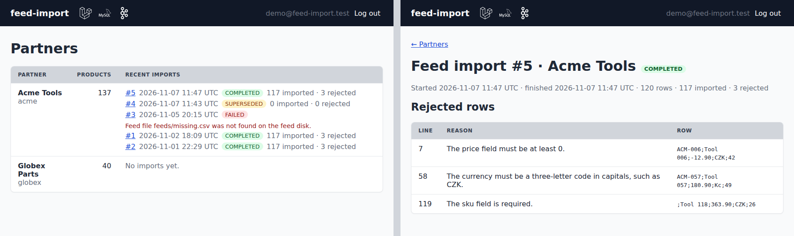
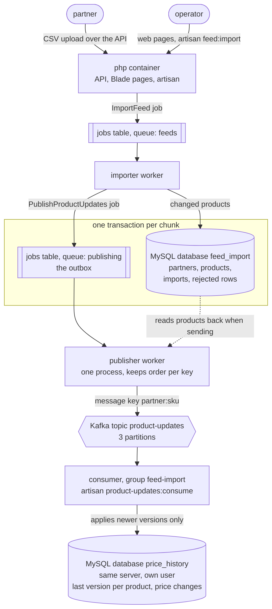

# feed-import

[](https://github.com/typllukas/feed-import/actions/workflows/check.yml)

Imports partner product feeds (CSV) into a catalogue and streams every change to Kafka. Laravel 13, MySQL 8.4,
Kafka 4.1. Only changed products are written and published, through an outbox that loses no announcement, and a
bad row is set aside without stopping the import. 100 000 products import in 26 s; the same feed with 1 % of
prices changed sends 1 000 messages, not 100 000.

A queued job validates the upload and upserts changed products in chunks, a separate worker publishes them, and a
consumer keeps a price history in its own database under its own MySQL user, sharing only the topic. Two Blade
pages show partners, imports and rejected rows.



**Example: a partner changes one price.** `make demo-change` re-imports the sample feed (117 valid products) with
ACM-001 cut from 12.90 to 9.90 CZK. The terminal output below shows the three steps:

1. the queue worker runs the import job and then the publish job; only ACM-001 changed, so only it is written
2. the consumer reads the topic and gets exactly one message, ACM-001
3. a query on the consumer's `product_price_changes` table shows the new price next to the previous import's

```text
Queued feed import #6 for acme.
  App\Jobs\ImportFeed ....................... 73.24ms DONE
  App\Jobs\PublishProductUpdates ............. 9.55ms DONE
Assigned partitions 0, 1, 2.
Partition 1 offset 1064518 acme:ACM-001: recorded
Consumed 1 message from product-updates.
+---------+-------+----------+----------------+---------------------+
| sku     | price | currency | feed_import_id | created_at          |
+---------+-------+----------+----------------+---------------------+
| ACM-001 |  9.90 | CZK      |              6 | 2026-11-07 11:11:49 |
| ACM-001 | 12.90 | CZK      |              5 | 2026-11-07 11:11:34 |
+---------+-------+----------+----------------+---------------------+
```

**How the parts connect**



**Where to start reading**

- [`ImportFeed`](app/Jobs/ImportFeed.php): streams the CSV, validates rows, writes only changed products chunk by
  chunk under the partner's lock and queues their announcement in the same transaction
- [`PublishProductUpdates`](app/Jobs/PublishProductUpdates.php): the relay from the outbox to Kafka
- [`ConsumeProductUpdatesCommand`](app/Console/Commands/ConsumeProductUpdatesCommand.php) and
  [`PriceHistoryRecorder`](app/Services/PriceHistoryRecorder.php): the consumer, applying only newer versions
- [`tests/Feature/Kafka/`](tests/Feature/Kafka) against the real broker, [`tests/Architecture/`](tests/Architecture)
  for the rules the code keeps

## Run it

Needs git, Docker Compose and GNU Make.

```sh
git clone https://github.com/typllukas/feed-import.git && cd feed-import && make setup
```

Setup takes about two and a half minutes from a fresh clone plus the base image downloads; `make help` lists the
other targets. GNU Make is optional: every target is a few `docker compose` commands, which can be run by hand from
the [`Makefile`](Makefile).

## Try it

In this order; each step shows one part of the design:

- `make demo`: **the whole pipeline on a first import.** Resets the data, imports the sample feed
  (`database/seeders/feeds/acme.csv`) with its bad rows set aside, publishes every product and consumes them into
  the price history.
- **The pages** at <http://localhost:8084>, login prefilled: **what an operator sees.** Each partner's recent
  imports with their status and counts, a failed one with its reason; open an import for its rejected rows, each
  with the line number, the reason and the original line.
- `make demo-change`, after it: **only changes go out.** The same feed again with one price changed gives one
  message and one new history row (the example above).
- `make consume-group`: **Kafka splits the work.** Two consumers in one group share the three partitions; when the
  first stops after 10 s, the second takes all three over.
- `make scale`: **the measurements below.** Imports 100 000 generated products, then the same feed with 1 % of
  prices changed, and prints how long each job took.

The REST API lives under `/api` with the header `X-Api-Token` (`change-me` locally): partners CRUD, a partner's
imports (`POST /partners/{partner}/feed-imports` uploads the CSV and answers 202), one import with its rejected
rows, and a partner's products with `?in_stock=1`.

## Only changes go out

A partner sends its whole catalogue every time, mostly unchanged. Each chunk compares the feed rows with the
stored products through Eloquent's `isDirty()` (`129.9` equals `129.90`); only new and changed products are
written, get a new `version` and are published. `make scale`, one worker, three runs on 6 Nov 2026:

| | import | publish | messages |
|---|---|---|---|
| 100 000 new products | 26 s | 3.7–4.1 s | 100 000 |
| same feed, 1 % of prices changed | 27–29 s | 0.7–1.0 s | 1 000 |

- Memory stays flat because the CSV is streamed: 38 MB for 10 000 rows, 40 MB for 100 000. Most of the import time
  is row validation, so the saving is in writes and messages.
- 1 000 rows a chunk, from runs between 100 and 5 000: above 250 the import time is within noise, publishing stops
  improving at 1 000, and bigger chunks hold the partner's lock longer.
- Rejected rows are written once per chunk: a feed of 100 000 bad rows takes 26–27 s, one insert per row took
  46 s, and a commit per row didn't finish 60 000 in the 300 s timeout.
- The consumer is the slow end, about 160 messages/s with a transaction per message: 10 minutes for a first
  100 000 import, 6 s for a nightly 1 % feed. A message costs 6.8 ms in its own transaction and 1.2 ms when a
  thousand share one, so batching its writes is the next step.
- Two partners import in parallel: 30 000 rows each on two workers, both done in 8 s, and a deadlock between their
  upserts reruns the chunk. One partner's chunks go in turn under its lock.
- Ceiling: about a million rows within the 300 s job timeout, about 240 000 within the 10 MB upload limit.

## The outbox

A database write and a broker publish can't share a transaction, so the import never publishes. It dispatches
`PublishProductUpdates` inside the chunk's transaction: **the `jobs` table is the outbox, the `publisher` worker
the relay, `failed_jobs` the dead letter.** Products and the promise to announce them commit together, or neither
does. This needs the queue on the products' own connection; Redis or SQS would dispatch outside the transaction.

With the broker down the import still ends `completed`, because the data is in. The publish job keeps retrying
for about six hours of failures, then waits in `failed_jobs` for `queue:retry`. It's a count (75 tries) rather
than `retryUntil()`, which runs from dispatch and would also expire jobs waiting behind a stopped worker.

Kafka carries the events, the database queue the work. RabbitMQ would earn its place with per-message delayed
retries or routing between services.

Import and publishing have separate queues and workers. On one shared queue, acme's first message hit the topic
after 48 s, behind globex's import; with separate workers, after 4 s.

## Keys, ordering and duplicates

Kafka orders only within a partition, so the key `<partner code>:<sku>` keeps every update of one product on one
of three partitions, in order. `enable.idempotence=true`, which implies `acks=all`, stops a retried batch
overtaking the next one, and `partitioner=murmur2_random`, the Java client's hash, puts a key where a Java producer
would; librdkafka's default CRC32 wouldn't. The partition count is fixed up front with topic auto-creation off,
since raising it later moves existing keys.

The client is `jobcloud/php-kafka-lib` over librdkafka; `mateusjunges/laravel-kafka` didn't install next to Laravel
13's Guzzle. jobcloud's `KafkaProducerBuilder` forces `socket.timeout.ms=50`, too short for `acks=all` on a
replicated cluster, so the producer is built from the library's classes instead.

Delivery is at-least-once, so the consumer doesn't rely on order. Each message carries the product's `version` and
is applied in one transaction that locks the product's row (`SELECT … FOR UPDATE`), only if the version is newer.
That one check covers a duplicate, a replay after a crash and a late older update, each printed as `stale`. A new
product's state row is inserted before it is locked: a locking read of a missing key takes a gap lock, and two
consumers inserting into the same gap would deadlock.

The consumer stands in for a downstream pricing service. Its MySQL user has rights on `price_history` only, so a
stray query into the importer's tables is refused by the database, and an architecture test keeps the code apart
in both directions.

## A bad row is data, a failing job is a failure

- **Wrong header** (anything but `sku;name;price;currency;stock`): refused on upload with a 422. Matching columns by
  position under wrong names would import valid-looking wrong data.
- **Unclosed quote**: fails the whole import, since the following rows would be read into one field or into a row
  carrying the next product's price.
- **Invalid row**: goes to `rejected_rows` with line number and reason, the import continues.
- **Failing job** (database down): three attempts with backoff, then `failed` with the reason. A retry starts over
  without duplicates, the upsert is idempotent.
- **Older feed after a newer one**: each chunk locks the partner's row and checks for a newer running or completed
  import, and if there is one, ends `superseded`. Otherwise a retried Monday feed would overwrite Tuesday's prices
  with a higher version the consumer accepts.
- **Broker unreachable**: not a failure of the import, see the outbox.

## Production and checks

`docker/php/Dockerfile` builds the dev image and, from one build, two production images: `production` (php-fpm or
either worker, no dev packages, code read-only except `storage` and `bootstrap/cache`) and `web` (nginx with
`public/`). A deployment runs the migrations once per release, since the containers don't on start, shares
`storage/app` between php-fpm and the importer, and gives workers a stop grace period above their job timeout
(330 s for the importer), where orchestrators often default to 30 s.

`make check` is the CI gate: Pint, Larastan level 10 and Pest against real MySQL and Kafka. Architecture tests hold
the import's single entry point and the consumer's boundary. Broker tests run against real Kafka: one key stays on
one partition in order and lands where the Java client puts it, a group splits the partitions, a duplicate is
recorded once, and an unreadable message stops the consumer without committing past it. The deadlock guard is not
tested. CI also builds both production images and serves `/up` through them.

## Limits

- One static API token for everyone; whoever has it can upload for any partner or delete one.
- A product missing from a new feed stays (no delisting); a duplicate SKU in one feed silently keeps the last row.
- Re-importing announces nothing unchanged, so nothing repairs a publish job lost from `failed_jobs` or a consumer
  down past the topic's 7-day retention. A replay command republishing current products at their versions would;
  not built.
- No dead-letter topic: an unreadable message stops the consumer until an operator moves the group offset past it.
  The only producer is this app, so such a message is a bug to fix, not data to park.
- Messages carry no schema version. A shape change would add a version header and upgrade consumers first.
- Feeds are pushed. Pulling them from a supplier URL on a schedule would put a download (size limit, unchanged file
  skipped) in front of the same import.
- No rate limit on uploads and no cap on rejected rows: a 10 MB file of one-character lines is 5 million of them.
